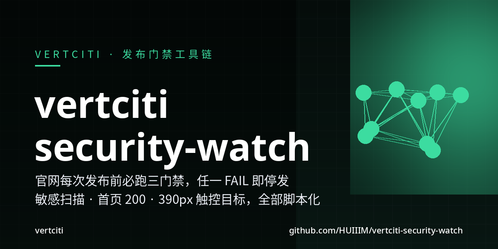
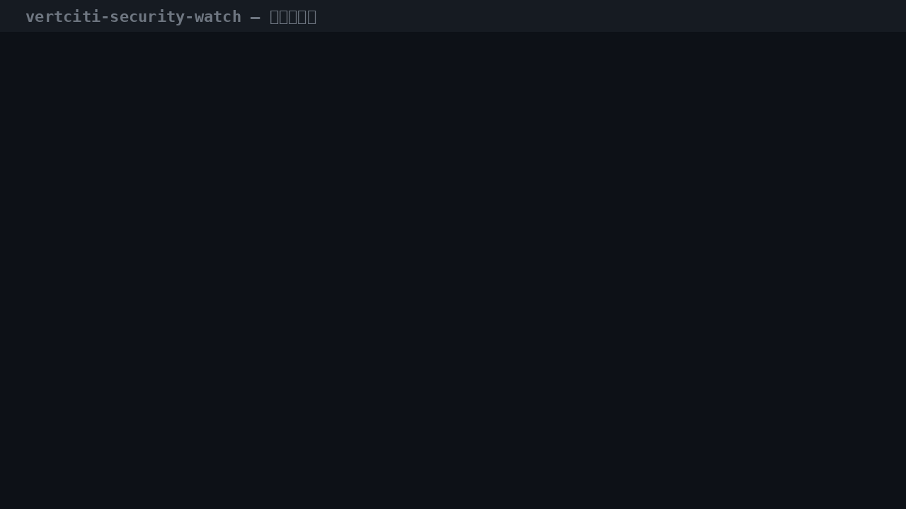
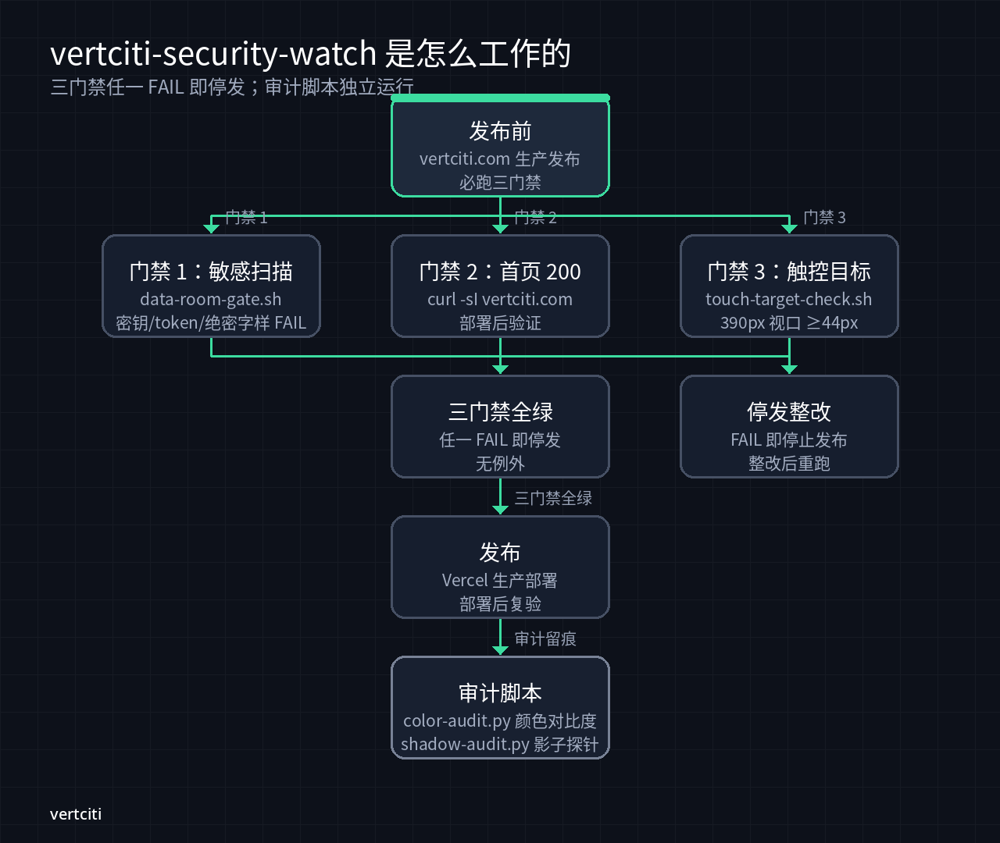
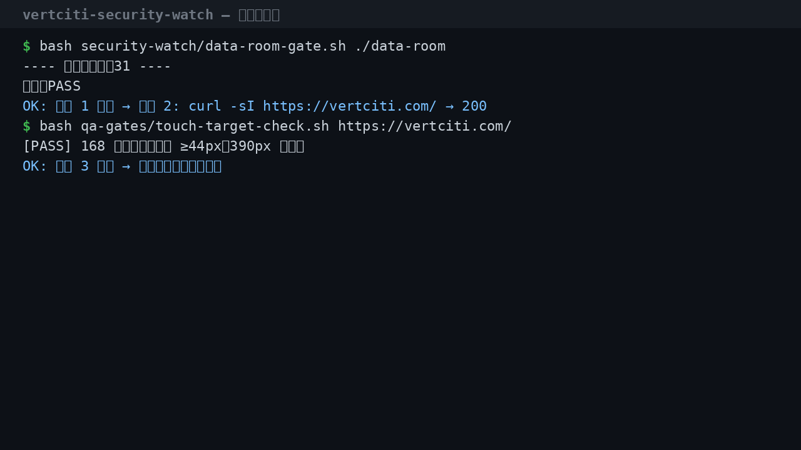

[](https://github.com/HUIIIM/vertciti-security-watch/actions/workflows/ci.yml)
[](https://github.com/HUIIIM/vertciti-security-watch/actions/workflows/gitleaks.yml)
[](LICENSE)

**vertciti.com 每次生产发布前必跑的三道门禁**——敏感信息扫描、首页 200、
390px 触控目标，全部脚本化；任一 FAIL 即停发，没有例外。

> **状态 / Status**：内部工具，维护中；尚无带版本号的发布（无 git tag）。脚本默认路径绑定维护者本机目录，
> 已知限制见 [docs/PRODUCT.md](docs/PRODUCT.md)。属于 [vertciti](https://vertciti.com)。
> Internal tool, maintained; no tagged release yet. Default paths assume the maintainer's machine;
> see [docs/PRODUCT.md](docs/PRODUCT.md) for known limitations. Part of [vertciti](https://vertciti.com).



> demo GIF 为本机真实运行：门禁 1 通过 → 门禁 3 通过 → 混入假密钥后 FAIL
> 停发。演示用假密钥（`ghp_fake…`），不含任何真实凭证。

## 30 秒 quickstart

```bash
cd vertciti-security-watch
bash security-watch/data-room-gate.sh --help   # 看门禁 1 的 FAIL/WARN 规则
bash security-watch/data-room-gate.sh ./data-room   # 扫一个目录（默认扫生产 data-room）
```

```bash
bash qa-gates/touch-target-check.sh https://vertciti.com/  # 门禁 3：390px 触控目标
curl -sI https://vertciti.com/ | head -1                   # 门禁 2：首页 200
```

## 它是怎么工作的



三门禁是发布流水线的硬门，不是建议：

| # | 门禁 | 脚本 | FAIL 条件 |
|---|---|---|---|
| 1 | 敏感信息扫描 | `security-watch/data-room-gate.sh [目录]` | 私钥 / `ghp_` 等 token / 绝密字样 / `2027-02` |
| 2 | 首页可访问 | `curl -sI https://vertciti.com/` → 200 | 非 200（部署任务内执行） |
| 3 | 触控目标 | `qa-gates/touch-target-check.sh [URL]` | 390px 视口下可交互元素 < 44px |

门禁 1 的 WARN（人工复核）：口令赋值、邮箱地址——在
`security-watch/gate-allowlist.txt` 登记误报，而不是放宽扫描器。



## 功能

- **门禁 1：data-room 敏感扫描**——2027-02 / 绝密字样 / 私钥 / token 为
  FAIL；口令赋值 / 邮箱为 WARN。默认扫描生产 `data-room/`。
- **门禁 3：390px 触控目标检查**——headless 渲染量取所有可见可交互元素
  boundingBox，断言宽高 ≥ 44px（WCAG 2.5.8）；纯文本内联链接豁免但留痕。
- **颜色对比度审计**（`color-audit.py`）与**影子探针审计**（`shadow-audit.py`）——
  独立运行的审计脚本，产物归档在 `security-watch/archive/`。
- **allowlist 机制**：误报在 `gate-allowlist.txt` 登记，扫描器本身不放水。

## 诚实约定

- 门禁脚本只做它声明的事：扫描/断言/报告，不自动改生产、不动防火墙。
- FAIL 就是停发——脚本 exit 1，发布流水线必须停，没有"这次先过"的开关。
- 影子探针（shadow-audit）只观测记录，不向外推送。

## 测试

```bash
pip install pytest ruff
ruff check .          # lint（规则见 ruff.toml）
python3 -m pytest -q  # 8 个冒烟测试 / 8 smoke tests（2026-10-22 本地：8 passed）
```

CI（`.github/workflows/ci.yml`）：ruff + pytest、Python `py_compile`、shellcheck；
gitleaks 密钥扫描在 `.github/workflows/gitleaks.yml`。push 到 main 与 PR 时自动运行。

## 贡献

本仓库为 vertciti 内部工程，暂不接受外部 PR；发现问题请走内部渠道。

## 关于 vertciti

vertciti 为 Miao 构建运营人生的个人 AI 基础设施。

## 安全 / Security

发现安全问题请勿开公开 issue，按 [.github/SECURITY.md](.github/SECURITY.md) 的流程私下报告。
Please do not open a public issue for vulnerabilities; follow [.github/SECURITY.md](.github/SECURITY.md).

已知限制 / Known limitation：`data-room-gate.sh` 从 `$HOME/workspace/vertcity/security-watch/gate-allowlist.txt`
读取 allowlist；该目录不存在时多数检查会被跳过并输出 PASS（私钥块检查除外）。在其他机器上运行前请先创建该目录。
If that allowlist directory does not exist, most checks are skipped and the gate reports PASS
(the private-key check still runs). Create the directory before running elsewhere.

## 许可证 / License

专有许可（非开源）：LICENSE 原文为 "vertciti clean-room engineering — proprietary.
Copyright (c) 2026 vertciti. All rights reserved." 详见 [LICENSE](LICENSE)。
Proprietary, all rights reserved — see [LICENSE](LICENSE).
